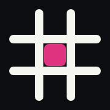
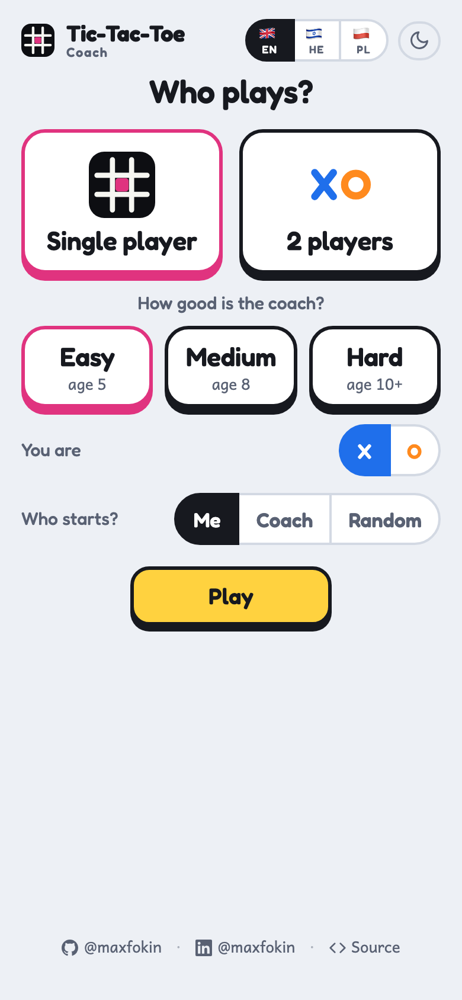
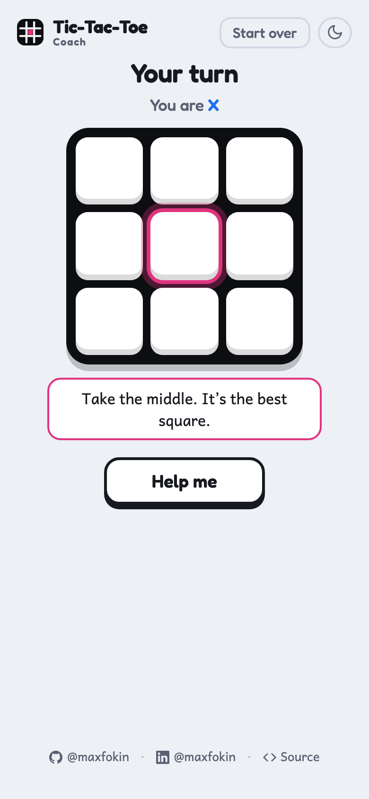
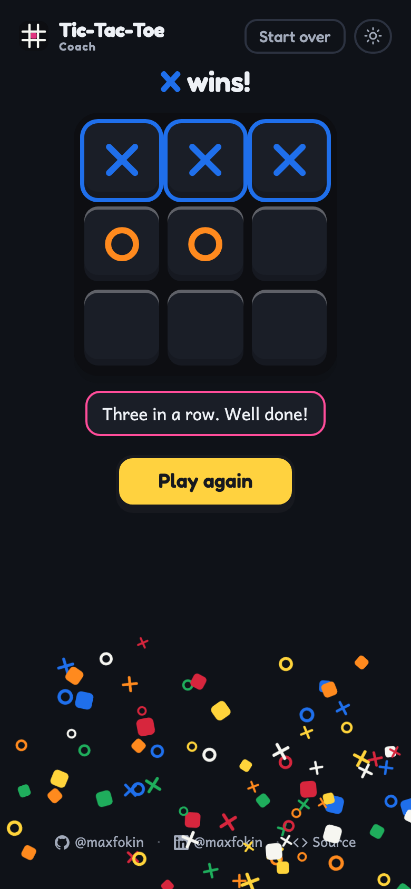

<p align="center">
  
</p>

<h1 align="center">Tic-Tac-Toe Coach</h1>

<p align="center">
  A friendly web app that plays tic-tac-toe with a child and teaches them to see the board.<br>
  <a href="https://maxfokin.github.io/tic-tac-toe/"><strong>Open the app →</strong></a>
</p>

<p align="center">
  
  
  
</p>

## How it works

1. **Set up in one screen.** Single player or two players, how good the coach is, which mark you
   play and who starts. The app remembers it, so the next game is one tap.
2. **Play.** Tap a square. The coach answers and says in one line what it saw.
3. **Stuck? Tap Help me.** The best square lights up with the reason. Nothing appears on its own.

## Features

- 🎓 **Three coaches** for three ages: Easy (age 5) slips often, Medium (age 8) wins when it can and
  blocks when it must, Hard (age 10+) never loses.
- 💡 **Help me with a reason.** Take the middle, block here, make two threats at once: the coach rings
  the square and says why. After a loss it says what the child could have done.
- 👫 **2 players** on one phone, and the coach helps whoever taps Help me.
- 🌍 **English, Hebrew and Polish.** It opens in the phone's language, and a switch on the first screen
  overrides it. Hebrew runs right to left while the board stays put.
- 🌙 **Light and dark**, following the phone until the moon button says otherwise.
- 📱 **Made for one hand on a phone:** big squares, one action per screen, and it works from the home
  screen.
- 🔒 **Nothing leaves the phone.** There is no server, no account and no tracking.

## Put it on a phone

Open **https://maxfokin.github.io/tic-tac-toe/** in Safari or Chrome, then *Share → Add to Home
Screen*.

## Under the hood

The whole app is one file, `index.html`, built from `src/` by `build.py`: plain HTML, CSS and
JavaScript, no framework, no dependencies, no build step beyond concatenation.

| File | What it does |
|---|---|
| `game.js` | The rules and the coaches: wins, forks, the three levels, the reason behind every hint. No DOM |
| `strings.js` | Every word a person reads, in English, Hebrew and Polish |
| `ui.js` | Screens, state, the board, confetti, the grey day, language and theme |

Fonts are Fredoka, Andika and Assistant from Google Fonts.

## Develop

```bash
python3 build.py          # writes index.html from src/ (--check: exits 1 when it is stale)
npm test                  # Node tests: the game logic and the strings, no DOM
```

The browser tests run in headless Chromium through Playwright:

```bash
python3 -m venv .venv && .venv/bin/pip install playwright==1.60.0 && .venv/bin/playwright install chromium
source .venv/bin/activate
npm run e2e                       # the flows, in every language
npm run screens                   # every screen's English text and height against a snapshot
python3 tests/e2e/screens.py he   # the same walk in Hebrew (or pl)
python3 tests/e2e/screens.py en --fonts   # the walk with the web fonts, as on a phone (needs the internet)
python3 tests/e2e/screenshots.py  # refreshes the screenshots above (needs the internet for the fonts)
```

Edit `src/`, rebuild, run the tests, and commit `index.html` together with the sources. Every push to
`main` goes live on GitHub Pages within a minute.

## Author

Built by Max Fokin for his son, together with Claude.
[GitHub](https://github.com/maxfokin/) · [LinkedIn](https://www.linkedin.com/in/maxfokin/)
